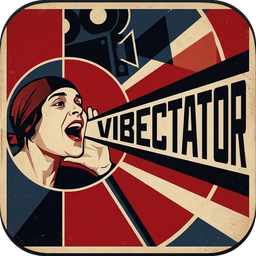

# Vibectator — локальная диктовка на GigaAM


[](https://github.com/sas2sas/vibectator/actions/workflows/ci.yml)
[](LICENSE)

Офлайн-ввод текста голосом для Windows: держите клавишу, говорите, отпускаете — распознанный
текст появляется в активном поле. Всё считается на вашем компьютере, аудио никуда не уходит.

Рассчитано на русскую речь: движок — [GigaAM-v3](https://huggingface.co/ai-sage/GigaAM-v3)
(CT-CTC, ~9% WER на русском против ~25% у Whisper large-v3), модель сама расставляет
пунктуацию и заглавные буквы.

## Что умеет

- **Удержание клавиши**: нажали → говорите → отпустили → текст вставлен.
- **Работает офлайн**: после установки интернет не нужен, речь не покидает машину.
- **0,3–0,7 с** на фразу (CPU, i5-1240P; RTF ≈ 0,05–0,1).
- **Защита от шума**: если в записи нет речи (Silero VAD), распознавание не запускается.
- **Три способа вставки**: печать через SendInput, Ctrl+V, только в буфер обмена.
- **Режим без хоткея**: окно с кнопкой — для систем, где перехват клавиатуры запрещён.
- Буфер обмена и `last_text.txt` как страховка, если вставка не прошла.

## Требования

- Windows 10/11 x64.
- **Права администратора при запуске.** Процесс с пониженными правами (LOW) Windows не
  допускает ни к клавиатуре, ни к печати в другие окна, ни к общему буферу — диктовка будет
  распознавать речь, но текст никуда не попадёт. Уровень виден в первой строке лога.
- Для запуска из исходников: Python 3.10–3.12. Для установщика — ничего не нужно.
- ~4 ГБ на диске для исходной установки (torch + модель), ~350 МБ для готового приложения.

## Установка

```bash
git clone https://github.com/sas2sas/vibectator.git
cd vibectator
```

```powershell
# правый клик по setup.ps1 -> "Выполнить с помощью PowerShell"
./setup.ps1
```

Скрипт создаст `.venv-gigaam`, поставит зависимости и скачает модель GigaAM-v3 (~420 МБ).
Интернет нужен только на этом шаге.

## Установка как обычного приложения (без Python)

Для тех, кому нужен просто установщик: `Vibectator-Setup-*.exe` (~180 МБ, модель внутри).
Ставится в Program Files, создаёт ярлыки в меню Пуск и на рабочем столе, `exe` требует прав
администратора. Python и интернет на машине не нужны.

Настройки, логи и `last_text.txt` при установке через установщик лежат в
`%LOCALAPPDATA%\Vibectator` (если папка недоступна — рядом с `exe`).

### Сборка установщика

1. Окружение сборки (без torch): `.venv-build` с `onnxruntime`, `numpy`, `sounddevice`,
   `keyboard`, `pyperclip`, `pystray`, `pillow`, `sentencepiece`, `pyinstaller`.
2. Экспорт модели в ONNX (один раз, нужен torch):
   ```
   python export_onnx.py      # fp32
   python quantize_onnx.py    # int8, ~225 МБ
   python verify_onnx.py samples/en_test.wav   # сверка с torch
   ```
3. `build.cmd` → `dist\Vibectator\Vibectator.exe` (~330 МБ).
4. Inno Setup 6: `iscc installer.iss` → `installer\Vibectator-Setup-1.0.0.exe`.

Как это устроено: GigaAM экспортируется в ONNX-граф «мел-признаки → CTC»; STFT считается на
numpy (`features.py`), потому что ONNX не поддерживает комплексные числа; декодирование —
CTC + SentencePiece. Квантование int8 даёт расхождение логитов 1e-4 и идентичный текст.

## Использование

```
run.cmd          # запуск (от имени администратора!), иконка в трее
stop.cmd         # остановить
run-window.cmd   # режим с кнопкой вместо горячей клавиши
```

1. Запустите `run.cmd` **от имени администратора** и дождитесь строки `модель готова`
   (первый старт — 10–20 секунд).
2. Поставьте курсор в нужное поле, **держите `CapsLock`**, говорите, отпустите.
3. Текст появится в поле примерно через полсекунды.

Клавишу можно поменять в `config.json` (`"hotkey": "f8"`, `"tilde"`, `"ctrl+alt+d"`).
CapsLock, NumLock, ScrollLock и `Ё/~` при этом «проглатываются», чтобы не переключать режимы.

## Настройки — `config.json`

| Ключ | По умолчанию | Смысл |
|---|---|---|
| `engine` | `onnx` | `onnx` (без torch), `gigaam` (torch), `whisper` |
| `gigaam_revision` | `e2e_ctc` | `e2e_ctc`, `e2e_rnnt`, `ctc`, `rnnt` |
| `hotkey` | `capslock` | одна клавиша или комбинация через `+` |
| `mode` | `hold` | `hold` — держать; `toggle` — нажал/нажал |
| `insert_method` | `type` | `type` (SendInput), `paste` (Ctrl+V), `clipboard` |
| `input_device` | `null` | номер микрофона из `--list-devices` |
| `vad` | `true` | не распознавать записи без речи |
| `cpu_threads` | `8` | потоки CPU |
| `max_seconds` | `60` | предохранитель от зависшей записи |

Полный список — в `config.example.json`. Файл `config.json` создаётся при первом запуске.

## Диагностика

```
.venv-gigaam\Scripts\python.exe dictate.py --list-devices   # микрофоны
.venv-gigaam\Scripts\python.exe dictate.py --record 5       # записать 5 с и показать текст
.venv-gigaam\Scripts\python.exe dictate.py --watch-keys     # видит ли программа хоткей
.venv-gigaam\Scripts\python.exe dictate.py --insert "текст" # проверить вставку
```

Всё пишется в `dictation.log`: уровень прав, длительность записи, время распознавания,
распознанный текст и окно, куда ушла вставка.

### Типичные проблемы

- **`уровень целостности процесса: LOW`** — запущено без прав администратора. Клавиатура и
  вставка работать не будут. Запустите через «Запуск от имени администратора».
- **Хоткей не срабатывает** — клавишу заняла другая программа либо процесс запущен с низкими
  правами. Проверьте `--watch-keys`; попробуйте другую клавишу.
- **Распознаётся, но не вставляется** — приложение-получатель запущено с более высокими
  правами. Текст уже в буфере и в `last_text.txt`, вставьте вручную.
- **Не слышит тихую речь** — уменьшите `min_speech_seconds` или отключите `vad`.

## Как это работает

- Запись — `sounddevice`, 16 кГц моно.
- VAD — Silero (из `faster-whisper`) отсекает записи без речи.
- Распознавание — GigaAM-v3 через `transformers` (`trust_remote_code`), CPU, без GPU.
  Загрузчик аудио модели подменяется, чтобы не требовать ffmpeg.
- Вставка — `SendInput` с `KEYEVENTF_UNICODE` (корректная структура `INPUT` на x64),
  плюс копирование в буфер обмена.
- Хоткей — низкоуровневый хук `WH_KEYBOARD_LL`; при недоступности — `RegisterHotKey`.

## Ограничения

- Только Windows (используются Win32 API для хука, вставки и трея).
- Модель ориентирована на русский; английский распознаёт, но пунктуация хуже.
- Записи длиннее 20 секунд режутся на куски — на стыках может теряться контекст.
- Для полноценной работы нужны права администратора (см. выше).

## Лицензия

MIT. Модель GigaAM-v3 распространяется по MIT, веса скачиваются отдельно.
